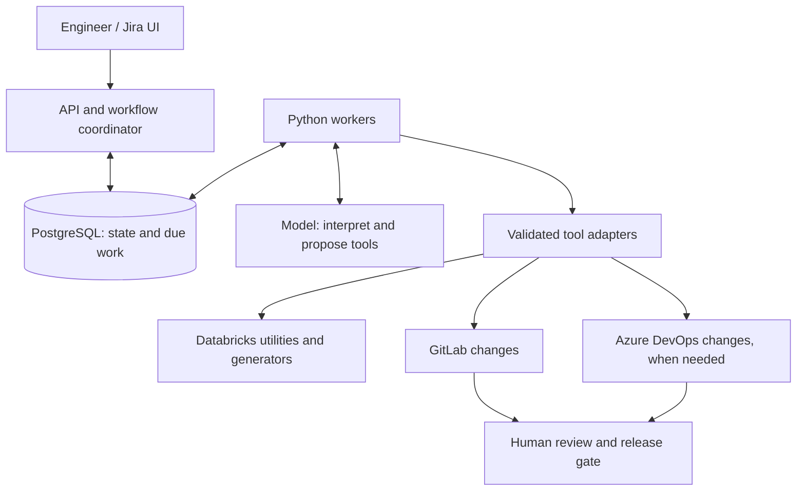

# AI-Assisted Data Integration

**An enterprise architecture case study on turning Jira requests into review-ready data integration changes.**

I helped design and roll out AI-assisted onboarding for two enterprise frameworks: **legacy database ingestion** and **SAP BW file delivery**. I contributed across technical discussions, planning, workflow design, Databricks job invocation and initial rollout. Both workflows went live during my involvement.

## The problem

Onboarding a new source meant checking access, discovering schemas, preparing mappings or parameters, running generators and coordinating changes across repositories. We used an AI orchestrator to interpret standardized Jira requests, read framework-specific instructions and invoke existing engineering tools through MCP and APIs.

## Two workflows

| | Legacy databases | SAP BW |
|---|---|---|
| Input | Oracle and SQL Server tables | Interface files on a shared FTP server |
| Preparation | Discover metadata and generate mappings and configuration | Fetch the interface schema with a Databricks notebook and run the existing Python generator in a GitLab working copy |
| Runtime | Two ADF pipelines per table, from source to RAW and from RAW to STAGE | One dedicated ADF pipeline per interface, using a common structure and parameters for the interface, target table and FTP filename |
| Review | Framework configuration in GitLab | Framework artifacts in GitLab and the interface-specific ADF definition in Azure DevOps |

## Reference architecture

The public design adds explicit workflow state, retries, recovery and release controls to the integration patterns above. It uses synthetic examples and generalizes internal implementation details.

- **Deterministic generation.** The model interprets the request and proposes actions. Existing utilities handle schema discovery, mappings and artifact generation.
- **Durable execution.** Workers record operation identity before submission and reconcile uncertain outcomes before retrying.
- **Human review and release.** Changes are reviewed in their respective repositories. The proposed release gate activates compatible revisions together.

## Explore the design

- [System architecture and release controls](docs/architecture.md)
- [Workflow lifecycle and failure recovery](docs/orchestrator.md)
- [Legacy database onboarding](docs/legacy-db.md) and [SAP BW onboarding](docs/sap-bw.md)
- [End-to-end SAP BW walkthrough](docs/walkthrough.md)
