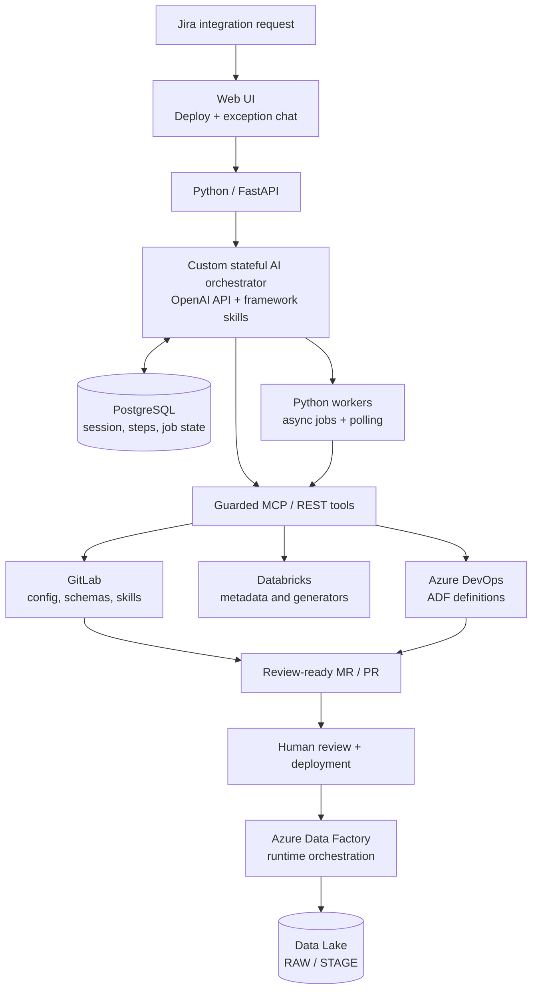

# AI-Driven Data Integration Platform

**An architecture case study in making enterprise data-pipeline onboarding less manual.**

The ETL frameworks already exist. The difficult part is often everything around them: understanding a Jira request, checking a source connection, retrieving schemas, generating mappings, updating configs, and preparing the change for review.

This project explores a practical approach to that problem: a **skill-driven AI orchestrator** that works with existing data engineering tools instead of asking an LLM to invent new pipelines from scratch.

> **Scope:** This is an independent, architecture-only reference design inspired by hands-on work with enterprise data integration. It is **not** an exported production system, a working deployment, or a copy of an employer's internal implementation. All names and examples are generic.

## The idea

An engineer selects a standardized Jira ticket and clicks **Deploy**. An AI orchestrator reads the relevant framework instructions (`SKILL.md`), inspects requirements, and calls approved tools via MCP or REST APIs.

It aims to prepare a validated **review-ready change**, not to silently deploy into production. If it hits a missing connection, a failed tool, or an ambiguous requirement, it pauses and asks a specific question in the same UI chat.

## Two integration patterns

| | Legacy databases | SAP BW file delivery |
|---|---|---|
| Input | Oracle / SQL Server tables | CSV extracts, schema and transfer flags via FTP |
| Provisioning | Read source metadata, generate RAW and STAGE mappings, create JSON config | Register interface/country, fetch schema, run existing Python generator |
| Runtime | **Two ADF pipelines**: source → RAW, RAW → STAGE | **One ADF pipeline** with three Databricks steps |
| Output | Configuration ready for review | Schemas, transformation SQL and ADF definition ready for review |

The orchestrator can choose tools and react to their results. Python still owns permissions, execution state, validation, retries, and the boundary before deployment.

## Design decisions

- **Custom Python orchestrator, not a multi-agent framework.** There are two well-understood workflows; dynamic AI decisions are bounded by explicit rules.
- **Direct OpenAI API.** Used for request interpretation, framework/tool selection, and explaining blockers.
- **PostgreSQL + dedicated worker.** A durable session and job records let a long-running Databricks call finish without keeping an HTTP request open. No message broker in this reference design.
- **Skills alongside framework documentation.** Versioned `SKILL.md` files describe what each framework needs. They are instructions, not executable code or permission grants.
- **Human-in-the-loop only on exceptions.** The assistant asks for missing input and resumes after validation; it does not invite arbitrary mid-run edits.
- **Git as the handoff.** The success criterion is validated artifacts and a merge/pull request. Engineers decide when to merge and deploy.

## Read the architecture

- [System overview and design trade-offs](docs/architecture.md)
- [AI orchestration: tools, waiting, recovery and chat](docs/orchestrator.md)
- [Legacy database framework](docs/legacy-db.md)
- [SAP BW file-based framework](docs/sap-bw.md)

## Technology map

Python · FastAPI · OpenAI API · MCP / REST · PostgreSQL · Azure Container Apps · Databricks · Azure Data Factory · Azure Data Lake · GitLab · Azure DevOps · Azure Key Vault

## What this repository is (and isn't)

This is a **system design portfolio piece**, deliberately light on code and focused on decisions, boundaries and data flow. The diagrams describe a proposed implementation; they are not evidence that all components were built, load-tested, or deployed together. No credentials, proprietary integrations, internal schemas, or customer data are included.
