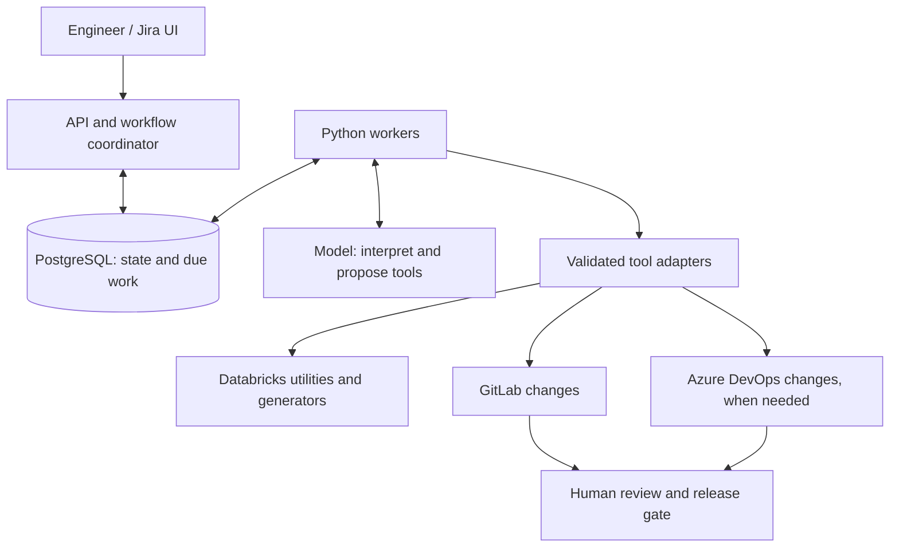

# AI-Assisted Data Integration
### From a Jira request to a review-ready integration change

Onboarding a data source often involves more manual coordination than new ETL code: read the request, check a connection, discover the schema, prepare mappings, update configuration and send the changes for review.

This case study shows how an AI orchestrator can handle that preparation by calling existing data engineering tools. The ingestion frameworks remain responsible for moving and transforming data.

## Experience behind the design

I participated across the full delivery cycle of AI-assisted onboarding for two enterprise integration frameworks: legacy databases and SAP BW file delivery. My involvement included technical discussions, planning, design, invoking jobs and supporting the initial rollout. Both were brought into use during my involvement. The early workflows worked, encountered errors and required engineering intervention.

This portfolio reconstructs the integration patterns at a generic level and proposes a more explicit design for durable execution, recovery and review. It does not describe the employer's current system or claim that every component shown here was deployed together.

| Grounded in the original work | Specified for this reference design |
|---|---|
| Standardized Jira requests and a UI with chat | FastAPI, custom Python runtime and PostgreSQL-backed workers |
| Framework-specific instructions and MCP/API tool calls | Explicit state transitions, bounded retries and recovery rules |
| Existing Databricks metadata utilities and generators | Isolated working copies and a defined Git publishing adapter |
| Legacy DB and SAP BW onboarding; GitLab and Azure DevOps | Version-paired release checks and activation gates |

No employer code, internal identifiers, real source schemas or production data are reproduced. All examples are synthetic. This is an architecture case study, not a runnable product.

## The system at a glance

The coordinator owns progress and permissions. The model proposes the next allowed action. Workers execute validated calls and persist their results. Successful preparation ends with review requests; ingestion starts through a separate release process.

## Two integration patterns

| | Legacy databases | SAP BW |
|---|---|---|
| Source | Oracle / SQL Server tables | Interface files on a shared FTP server |
| Preparation | Discover metadata; generate two mappings and JSON configuration | Add interface parameters; fetch schema; run the existing Python generator |
| Generated artifacts | Ingestion configuration and mappings | RAW schema, STAGE schema and RAW-to-STAGE SQL |
| Runtime | Two ADF pipelines per table: source to RAW, then RAW to STAGE | One dedicated ADF pipeline per interface, with three Databricks processing steps |
| Repository boundary | Framework configuration in GitLab | Framework files in GitLab; interface-specific ADF definitions in Azure DevOps |

SAP BW pipelines share the same structure. Each pipeline name contains the interface name, and its parameters identify the interface, target table and source filename on FTP.

An event-based framework existed in the wider platform. This case study deliberately covers only the first two patterns.

## Where the engineering decisions matter

- **Reuse the frameworks.** The model does not invent source columns or implement full/merge/watermark semantics.
- **Make long operations durable.** Save operation identity before submission; reconcile uncertain outcomes instead of blindly repeating them.
- **Separate instructions from authority.** A pinned skill explains a workflow. Backend policy decides which actions are permitted.
- **Keep two human checkpoints distinct.** Ask for missing information during preparation; require review and environment approval before release.
- **Coordinate versions across repositories.** When both repositories change, activate only a validated pair of revisions.
- **Define success narrowly.** A review-ready change proves preparation checks passed. It does not prove production data quality.

## Read this case study

| If you have... | Start here |
|---|---|
| 3 minutes | This page and [the interview guide](docs/interview-guide.md) |
| 10 minutes | [Architecture and release boundaries](docs/architecture.md) |
| A technical deep dive | [Workflow lifecycle and recovery](docs/orchestrator.md) |
| A framework question | [Legacy DB](docs/legacy-db.md) or [SAP BW](docs/sap-bw.md) |
| A request for a concrete example | [One synthetic request, end to end](docs/walkthrough.md) |

## Outcome and evidence

The practical benefit is reducing repetitive onboarding work while keeping existing ingestion logic and engineering review. I do not publish a measured time-saving percentage or a reliability benchmark here.

For an implementation, I would track active engineering minutes per approved integration, first-review acceptance, blocked-workflow reasons, duplicate external operations and post-release data checks. Comparison should use similar source types and separate hands-on time from waiting for infrastructure or approval.

**Reference stack:** Python, FastAPI, OpenAI API, MCP/REST adapters, PostgreSQL, Azure Container Apps, Databricks, Azure Data Factory, Azure Data Lake, GitLab, Azure DevOps and Azure Key Vault. The hosting and persistence choices are proposals, not claims about the original deployment.
