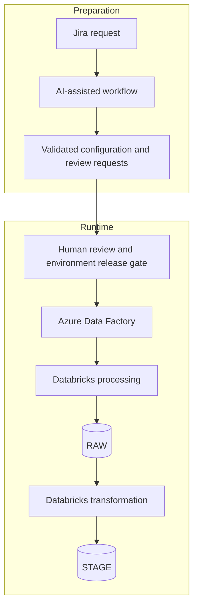

# Architecture and release boundaries

The system prepares integration changes. Existing ADF and Databricks frameworks execute the data pipelines. This separation keeps model decisions out of routine ingestion.

## Responsibilities

| Component | Responsibility |
|---|---|
| UI and FastAPI | Authenticate the engineer; create or reconnect to a workflow; show progress and pending questions |
| Workflow coordinator | Enforce state transitions, budgets, allowed tools and completion checks |
| Model | Interpret the request, select a framework and propose permitted calls or a clarification |
| PostgreSQL | Persist workflow revisions, operations, due work, questions and audit references |
| Python workers | Claim work, call the model or adapters, poll external jobs and reconcile uncertain outcomes |
| Tool adapters | Validate arguments, restrict paths and resources, execute approved operations and return structured results |
| Databricks | Discover metadata, access FTP and run established generators |
| GitLab | Version framework code, instructions, parameters, schemas, mappings and generated SQL |
| Azure DevOps | Version ADF definitions and operate the reviewed deployment process |
| Release controller and engineer | Validate environment-specific revisions, approve release and enable ingestion |

The API and workers are separate proposed Azure Container Apps workloads. PostgreSQL is the source of durable state. The worker must remain available, or be scheduled independently of incoming HTTP requests; closing the browser does not stop the workflow. Live UI updates are optional notifications, not the durable record.

## Preparation versus runtime

RAW and STAGE storage details depend on the framework. ADF coordinates execution; Databricks performs the processing. A failed runtime job is an operational incident, not an instruction to let the provisioning agent change production automatically.

## GitLab and Azure DevOps are separate repositories

GitLab holds the framework artifacts. Azure DevOps holds ADF definitions. Every new SAP BW interface has its own ADF pipeline, with the interface name included in the pipeline name. The structure is shared across the framework; the interface name, target table and source filename on FTP are parameterized. Onboarding a new SAP BW interface therefore prepares both a GitLab MR and an Azure DevOps PR for its dedicated pipeline definition.

Routine legacy database onboarding can reuse the existing ADF generator without changing its definition. In that case, record the approved ADF revision and compatibility check rather than creating an unnecessary PR.

A change-set record links the Jira request, workflow revision, GitLab commit/MR, applicable Azure DevOps commit/PR, checks and target environment. The ID provides traceability; it does not make the merges atomic.

### Proposed release protocol

1. Review each required change independently. Approval applies to exact revisions; a changed diff invalidates the affected checks and approval.
2. Resolve the reviewed changes to immutable release revisions. If merging or rebasing changes the resulting content, validate that result.
3. Record the GitLab revision, ADF revision and validation evidence in an environment-specific release manifest.
4. Deploy the selected artifacts to the target environment while the affected integration remains inactive.
5. Check that both deployed revisions match the manifest, then activate that integration. Run smoke/data checks appropriate to that environment.
6. Promote through dev, test, QAS and production using the normal human approval process. Promote versioned artifacts, not an arbitrary current branch head.

The release manifest and activation gate are **proposed improvements**, not assertions about the historical platform. An implementation must enforce the gate in the deployment/runtime layer. In particular, a scheduled discovery process must only see released configurations or must check release eligibility before creating or enabling pipelines. A document alone cannot enforce this rule.

| Partial outcome | Required behavior |
|---|---|
| Only one review is approved | Keep the change unready for release |
| Only one repository change is merged | Preserve traceability; do not activate the pair |
| One deployment fails | Keep the new integration inactive; repair or redeploy the approved pair |
| A deployed revision differs from the manifest | Block activation and revalidate |
| Smoke checks fail after activation | Pause affected triggers; restore the previous approved artifact pair when safe |

Reverting configuration does not undo data already written. Recovery of data needs its own reconciliation or replay procedure. For changes to an active integration, quiesce new runs and account for in-flight work before switching versions.

## Why these implementation choices?

**Custom Python runtime.** The workflow catalog is narrow. Model calls sit inside an explicit state machine; the model does not own the lifecycle. This avoids adding a framework solely for routing, but durable recovery and human pauses still require engineering. A workflow framework becomes attractive if their maintenance cost or branching complexity grows.

**PostgreSQL-backed work queue.** At modest onboarding volume, short transactional claims, leases and due timestamps are enough for this design. No lock stays open during a Databricks job or model call. A broker would be a future throughput/isolation decision, not a prerequisite.

**Existing generators.** Framework rules and type transformations remain deterministic. AI helps interpret requests and blockers. It is not allowed to bypass validation or introduce unrestricted ETL code.

**MCP and REST.** Both are adapter interfaces. Neither supplies authorization, idempotency or orchestration automatically. The same backend policy applies to either transport.

## Trust and data boundaries

- Authenticate engineers and scope each workflow to allowed environments and resources.
- Keep credentials in the secret store. Pass references rather than secret values to tools.
- Pin skill and generator revisions; only trusted, reviewed instructions define the workflow.
- Treat Jira text, source files and tool output as data. They cannot add tools or expand permissions.
- Send the model only necessary request metadata and sanitized tool summaries. Credentials and raw business records stay outside model context.
- Redact logs and persisted tool results too; masking only the prompt is insufficient.
- Limit repository paths and changes. Reject unrelated edits, unexpected deletions and unapproved destinations.
- Record actor, workflow revision, operation, external run, commit and approval references.

## Supporting platform documentation

- [Databricks Git folders](https://learn.microsoft.com/en-us/azure/databricks/repos/git-folders-concepts)
- [Git-backed job source versus workspace Git folders](https://learn.microsoft.com/en-us/azure/databricks/jobs/git)
- [PostgreSQL row locking and queue consumers](https://www.postgresql.org/docs/current/sql-select.html)
- [GitLab commit actions](https://docs.gitlab.com/api/commits/)

These references support specific mechanisms. They do not establish that the complete proposed system has been implemented.
