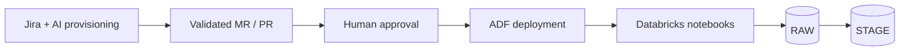

# Architecture overview

The goal is narrow: **turn a standardized Jira request into reviewed integration configuration**. Data ingestion itself remains with the established Azure Data Factory / Databricks frameworks.

## Responsibilities

| Component | Owns | Does not own |
|---|---|---|
| React UI / FastAPI | Session creation, progress events, exception chat | ETL execution |
| OpenAI model | Interpreting Jira, selecting a skill/tool, summarizing failures | Credentials, permissions, deployment |
| Custom Python orchestrator | Allowed transitions, tool dispatch, workflow completion | Making up source schemas |
| PostgreSQL | Sessions, tool results, jobs, due-work queue, audit | External job execution |
| Dedicated worker | Running and checking asynchronous operations | Long-lived HTTP requests |
| Databricks utilities | FTP/schema discovery, mappings, Python generators | Arbitrary LLM-authored operations |
| GitLab | Framework configs, schemas and generated SQL | Production ADF deployment |
| Azure DevOps | Versioned ADF definitions and CI/CD | AI model decisions |

## Deployment boundary

The AI creates a feature branch from `dev` and prepares validated review changes. For the SAP BW path, the ADF definition may require a corresponding Azure DevOps pull request. The two review items share a change-set ID; they are **not** one atomic Git transaction.

A human reviews, merges and promotes the change through the normal environments. The runtime pipeline is not launched by the AI agent as part of provisioning.

## Two orchestration layers

The provisioning agent and runtime ETL lifecycle should be monitored separately. A successful MR does not prove successful production ingestion.

## Main choices and trade-offs

**Why custom Python rather than LangGraph?** With only two constrained workflows, a small state machine is easier to understand and debug. The price is that we must implement durable state transitions, retries, job reconciliation and human pauses ourselves. A durable workflow engine would be reasonable if the workflow catalog or concurrency grew significantly.

**Why PostgreSQL rather than a message broker?** At moderate volume, a database-backed work queue with leases and due timestamps is adequate. Worker claims should use short transactions; no database lock is held during a Databricks run. A separate broker becomes attractive when throughput, isolation or independent consumer groups warrant it.

**Why not ask the LLM to write the ETL?** Existing frameworks own full/merge/watermark logic, country rules and transformations. LLM decisions are useful for interpreting onboarding requests and responding to exceptional situations; deterministic tools are more reliable for the actual transformation contract.

**Why artifact staging?** Databricks outputs are validated as an explicit artifact manifest before a Git adapter commits them. A Git-backed workspace alone is not proof that generated files were committed and pushed.

## Security and quality gates

- User authentication and authorisation via enterprise identity; least-privilege service access.
- Credentials in Azure Key Vault, never pasted into prompts or chat.
- Tool allowlists, argument validation, pinned skill revisions and protected Git branches.
- Jira stories and source files are treated as untrusted data, not agent instructions.
- Validate source/target schemas, country mapping, SQL, load mode, paths and Git diffs before opening review requests.
- Correlate Jira ticket, workflow ID, Databricks run ID, Git commit and review URLs in audit events.

This page is a design proposal, not an attestation of a deployed environment.
