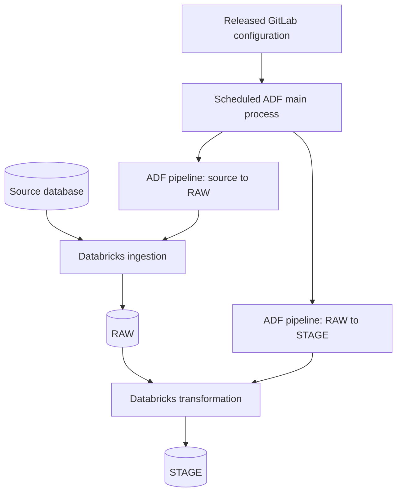

# Legacy database onboarding

The framework ingests tables from sources such as Oracle and SQL Server. Its existing notebooks own loading and transformation behavior.

## Preparation

1. Read the standardized request and the pinned Legacy DB skill.
2. Check the approved connection and secret reference. Ask the engineer to provision missing access; never request a password in chat.
3. Invoke the existing Databricks mapping notebook with source, schema and table parameters.
4. Receive the source-to-RAW and RAW-to-STAGE mappings. Preserve their provenance; do not infer missing columns from the ticket.
5. Prepare configuration in a GitLab feature branch from dev. Validate the expected diff and open an MR.

The configuration identifies the source connection, source and target objects, both mappings, load mode, applicable keys/watermark, technical columns and country partitioning.

Full, merge and watermark-based incremental loading are framework capabilities. They are not interchangeable strategies the model may select without the necessary source contract. For example, a merge configuration without the required key is rejected rather than guessed.

## Runtime and release

One source table provisions two ADF pipelines. In the original pattern, the main ADF process ran approximately every 30 minutes, called Databricks and discovered new JSON configurations to generate pipelines. That interval is background context, not a reference-design SLA.

A normal onboarding request changes GitLab configuration, not the shared ADF generator code. An Azure DevOps PR is needed only when an ADF definition or deployment component itself changes.

The proposed release gate ensures the main process consumes only released configurations. Before enabling a new configuration, check the deployed framework revision and required connection. The RAW-to-STAGE run must use a successful, identified RAW load; the diagram shows responsibilities, not permission to race both stages independently.

## Validation levels

| Before review | In a test environment | After release |
|---|---|---|
| Required fields and supported mode | Connection and access checks | Ingestion status and freshness |
| Source/mapping compatibility | Representative full/incremental run | Reconciliation and data-quality alerts |
| Keys, watermark and partition rules | Technical columns and target types | Failed loads and unexpected drift |
| Expected files and scoped Git diff | Rerun behavior for the chosen mode | Operational monitoring |

The case study specifies these checks; it does not contain test execution results. Retry and deduplication semantics belong to the existing framework and must be verified for each supported load mode.
