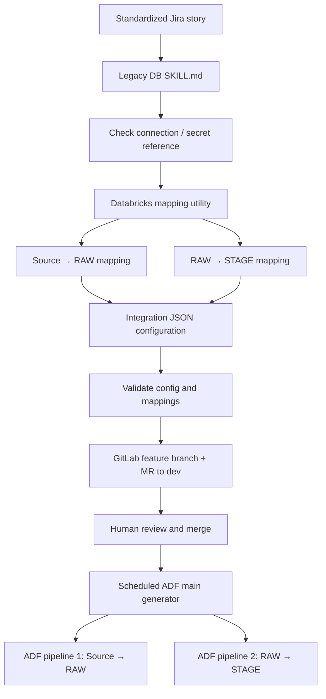

# Legacy database integration

This framework provisions ingestion from systems such as Oracle and SQL Server. It reuses existing notebook logic rather than synthesizing custom ETL for every table.

## Provisioning

## Configuration contract

Each table requires source connection, database/schema/table, target names, both mappings, load mode, keys or watermark where applicable, technical columns and partition columns. The framework can support **full**, **merge**, and **watermark-based incremental** loads; these execution semantics belong to the ingestion code, not the model.

The source-to-RAW mapping preserves incoming data while adding ingestion metadata. RAW-to-STAGE applies standardized types, technical fields and partitioning (for example country).

The mapping utility is an existing parameterized Databricks notebook. The agent calls it and incorporates the two returned mappings into the generated configuration; it does not guess the source schema.

## Runtime boundary

One source table provisions **two ADF pipelines**. The scheduled main process (approximately every 30 minutes in the source pattern) discovers approved new JSON configurations and generates pipeline definitions. ADF then invokes Databricks notebooks. Ingestion and stage processing have their own monitoring and alerts.

A successful configuration MR is only a provisioning milestone. Actual data validation happens after deployment.
