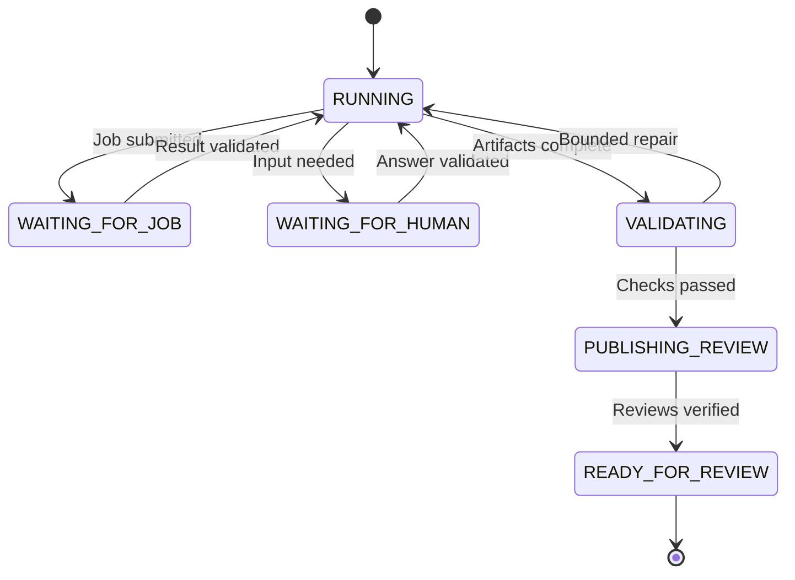

# Workflow lifecycle and recovery

One logical workflow can include several model calls, external jobs and a human pause. Its identity and state live in PostgreSQL. An HTTP connection or model conversation is not the execution engine.

## The bounded agent loop

The coordinator selects tools allowed for the current state and pinned skill. A worker asks the model for a structured proposal, validates that proposal and invokes the appropriate adapter. The adapter returns a typed result. The coordinator then decides whether to continue, wait, request input or fail.

Model output never grants permission. Deterministic checks decide whether preparation is complete.

The diagram shows normal progress and recoverable pauses. Shared failure and cancellation transitions are listed below to keep the lifecycle readable.

| From | Event | To |
|---|---|---|
| Any non-terminal preparation state | Unrecoverable error, policy violation or exhausted deadline/budget | FAILED |
| RUNNING, either WAITING state, VALIDATING or PUBLISHING_REVIEW | Authorized cancellation | CANCELLING |
| CANCELLING | Outstanding external outcomes reconciled | CANCELLED |
| CANCELLING | Reconciliation deadline exceeded | FAILED, with outstanding operations recorded |

Transient retries are operation records inside a state, not new workflows. A human reply cannot override the tool allowlist. READY_FOR_REVIEW, FAILED and CANCELLED are terminal for preparation. Approval, merging and deployment belong to the separate release lifecycle.

## Long operations

1. Persist an operation ID, canonical arguments, input revision and idempotency key before submitting.
2. Claim the operation under a short lease. Submit the approved Databricks job with the same external token on transport retries.
3. Persist the returned run ID. Release the worker and schedule the next status check.
4. A worker claims the due check and queries that run. Polling does not call the model.
5. On completion, validate the returned metadata or files before advancing the workflow. On failure, classify the cause and apply a bounded retry, clarification or failure policy.
6. If submission timed out, reconcile with the external service before creating a different execution attempt.

Databricks [run-now](https://docs.databricks.com/api/jobs/v2/run-now) supports an idempotency token that returns the existing run for repeated requests with that token. A deliberate rerun after a confirmed failed job is a new recorded attempt with a new token. This mechanism does not guarantee exactly-once effects for the entire workflow.

## Human input and mandatory approval

An exception question might ask an engineer to provision a missing secret and provide its reference. The workflow stores a question ID, required fields, permitted responder and expected revision.

The reply must match the current question and revision. Validate the reference through the tool, not by accepting the user's assertion alone. Expired or duplicate replies do not resume execution. A changed requirement creates a new workflow revision and invalidates affected outputs.

Review approval is different: every release needs human approval even when preparation required no questions. The UI action should be named **Prepare integration**; it does not promise production deployment.

## Failure policy

| Condition | Action |
|---|---|
| Timeout, rate limit or temporary service error | Bounded retries with backoff and jitter; reuse the same operation identity |
| Missing connection or ambiguous source/target | Ask a specific question and wait |
| Unsupported framework or forbidden tool arguments | Stop with an actionable reason; do not ask the model to bypass policy |
| Invalid generated artifacts | Allow only a bounded, explicitly supported repair; otherwise fail |
| Changed source schema or edited branch | Invalidate stale checks and regenerate/review against a new revision |
| No human reply or stalled external job | Enforce a configurable deadline and record the outstanding external state |
| Cancellation | Stop new dispatch; cancel permitted external work where possible and reconcile in-flight results |

Retries, model turns, token/cost budget, job duration and human-response deadlines are configuration values. Their numerical limits should be chosen from workload evidence, not invented for this case study. A FAILED outcome may still have an external job to reconcile; it must never be described as proof that all side effects were undone.

## Recovery cases that must work

| Failure window | Recovery rule |
|---|---|
| Duplicate click for the same Jira revision | Return the existing active workflow; an intentional rerun has an explicit new revision |
| Submission accepted, response lost | Reuse the operation token and reconcile the existing external run |
| Worker dies during a job | Reclaim due work; poll the recorded run rather than submitting again |
| Worker lease expires while a call is still running | Reject stale state writes; use external idempotency/concurrency controls before repeating side effects |
| Git commit or review created, result not saved | Locate it by branch, change-set and content identity; verify before repeating |
| GitLab MR exists but Azure DevOps PR creation fails | Retain the MR and retry only the missing publication step; do not report readiness |
| Requirements change during a human pause | Reject stale answers and revalidate affected steps |

Database leases alone cannot fence an already-running external request. Use single-writer ownership of each change branch, provider conflict checks and idempotent adapters. Unexpected external edits block publishing. Never force-push over them.

Persist conversation, workflow and external-operation records separately, linked by workflow ID and revision. Audit sanitized evidence, not secret payloads. Cleanup only workflow-owned temporary resources after outcomes have been reconciled.

## Readiness contract

READY_FOR_REVIEW requires all of the following:

- Required inputs and applicable mappings are complete.
- The expected artifact manifest matches the actual changed files.
- Deterministic validation has passed for the recorded revisions.
- Remote commits exist and match the reviewed content.
- Every required MR/PR exists and is linked; reused ADF revisions are documented.
- There are no unresolved blockers or unknown publication outcomes.

It does not imply reviewer acceptance, deployment or successful production ingestion.
