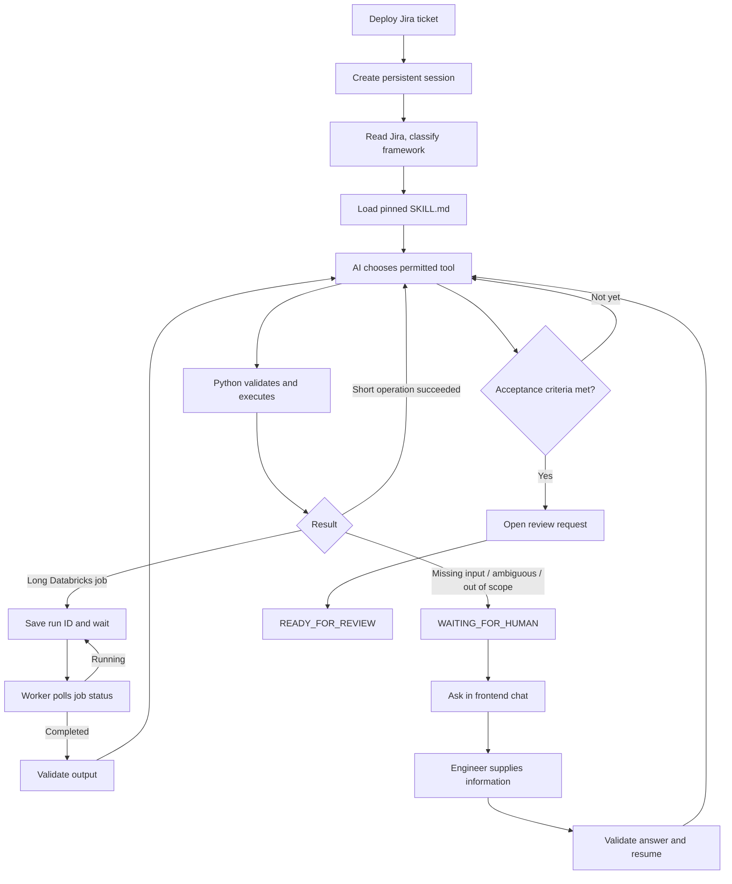

# AI orchestrator: the part that matters

This is a **single-agent, tool-driven workflow**, not a swarm of agents. The model can interpret a requirement, choose an allowed tool and inspect the result. Python controls the execution boundaries.

## Session lifecycle

The graph is a conceptual illustration. A real implementation must cap tool iterations, retries and cost. Terminal success is decided by deterministic validation and review-request creation, **not** by the LLM saying it is finished.

## Long-running Databricks operations

1. Create a durable operation record with a stable idempotency key.
2. Submit the allowed Databricks job; store its external `run_id`.
3. Move the workflow to `WAITING_FOR_JOB`; release the worker.
4. A separate worker claims due checks from PostgreSQL, queries the same run, and reschedules if still running.
5. On terminal success, fetch a small result or artifact URI and validate it. On failure, apply a bounded policy and/or ask the engineer.
6. Feed structured output into the agent loop if a new decision is needed.

Polling does not repeatedly invoke OpenAI. On restart, a recovery worker reconciles persisted external jobs rather than launching duplicates. For the ambiguous submit-then-timeout window, use external idempotency tokens where supported and reconcile before retrying.

## A chat that pauses only when needed

The chat is **exception-driven**, not a free-form remote control of an active job.

Example: a connection reference exists but the secret is missing. The orchestrator posts: *“I couldn't validate this connection. Please provision its secret and send me the reference name (not the password).”* The workflow moves to `WAITING_FOR_HUMAN`. When an authorised engineer replies, the backend validates the reference, records the reply, and resumes the same persistent workflow.

The browser can close without cancelling the run. The OpenAI API calls are individually short-lived: the **logical session lives in PostgreSQL**, not in an indefinitely open model connection.

## State and recovery

Keep conversation messages, workflow state and external execution state related by a common session ID but stored separately. Important fields include step, revision, skill commit, allowed tools, operation key, external run ID, last verified result, retry count, and pending human question.

Use short transactional claims/leases for worker coordination, unique operation keys, bounded retries, optimistic state versioning and a reconciliation scan for expired leases. Never hold a PostgreSQL transaction open while waiting for an external job.

## Where AI ends

Before any Git write, validate generated content with ordinary parsers and framework-specific rules. No arbitrary shell execution, direct writes to protected branches or autonomous production deployments. The last automated action is to create a **review-ready** change set.

This is an illustrative implementation design; it does not claim a particular workflow engine ran in the original environment.
