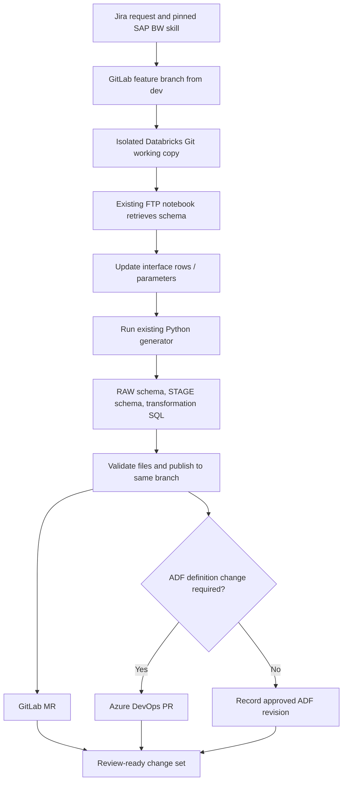
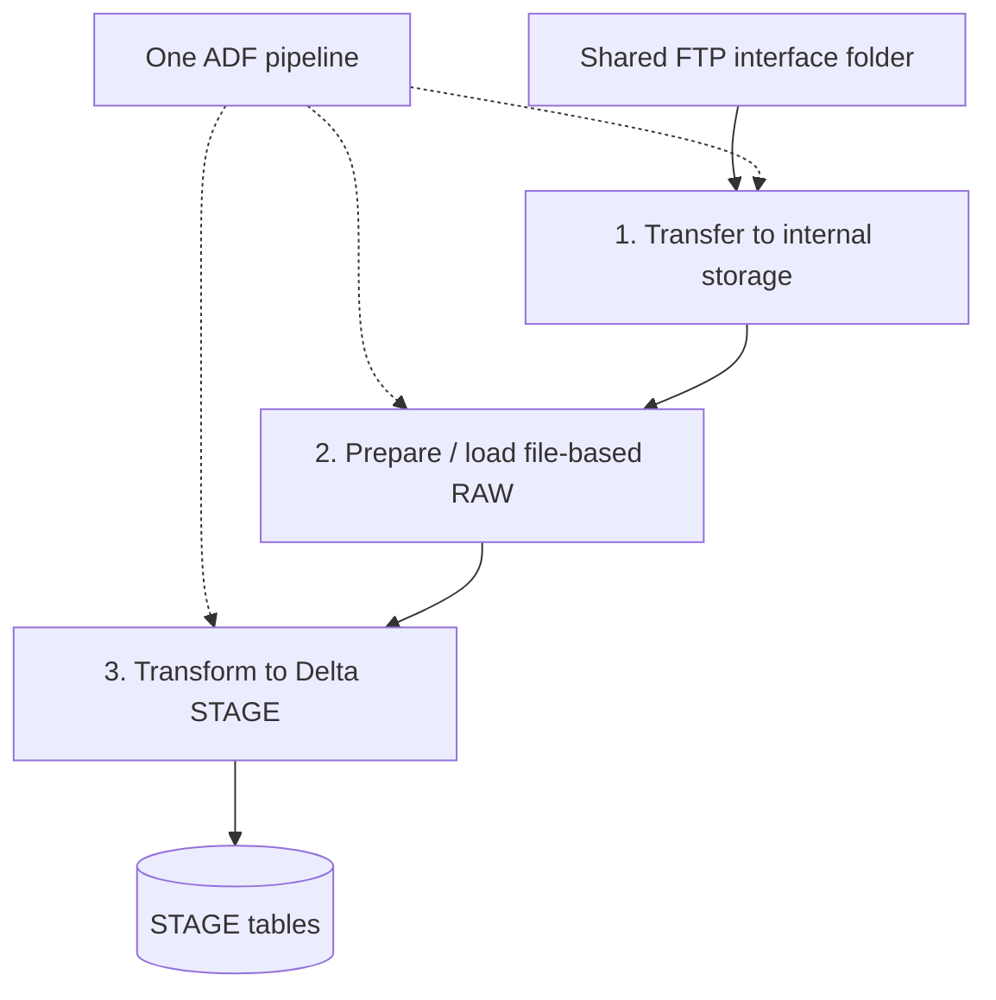

# SAP BW onboarding

SAP BW delivers interface files to a shared FTP server. The framework prepares file-based RAW data and transforms it into STAGE tables.

## The process behind this case study

An engineer adds interface-specific rows or parameters and runs an existing Python script to generate the required files. The framework artifacts belong to GitLab. The ADF pipeline definitions belong to a separate Git repository in Azure DevOps.

The AI-assisted path preserves that mechanism: create a feature branch from dev, attach a Databricks Git working copy to that branch, update the permitted parameters and run the existing generator there. Generated files remain in that working copy until validated and published to the same remote feature branch.

## Preparation

The FTP access is through the established Databricks notebook. ADF file copy is not substituted for that provisioning step.

### Working copy and publication

The reference design uses one working copy per workflow revision, with the branch and generator revision recorded before execution. Concurrent requests must not switch branches in a shared folder.

After generation, validation produces a manifest of allowed file paths and content hashes. This is a description of the files, not a second artifact repository or a new output-copy stage.

For this reference design, a constrained publishing adapter reads the validated small text files from that working copy and uses a GitLab batch commit to publish them to the same feature branch. The adapter verifies remote content and records the resulting SHA before opening the MR. This publishing implementation is a proposed choice, not a claim about the original commit mechanism.

The branch is workflow-owned during preparation. Check for unexpected edits before publication, use applicable provider file-conflict checks and verify the resulting diff. A conflict stops publication; there is no force-push. If a timeout leaves the outcome unknown, look for the matching commit before retrying. After successful publication, the temporary working copy can be retired; do not continue using an unsynchronized dirty copy.

A Databricks workspace Git folder and a job configured with a remote Git source have different file-write behavior. This generation path requires a writable workspace working copy and a supported runtime configuration. Merely setting a job's remote Git branch is not an equivalent implementation.

## File delivery and runtime

| File | Purpose |
|---|---|
| START flag | Marks the start of a delivery |
| Schema file | Describes source fields and types |
| CSV file | Contains the extracted records |
| END flag | Indicates the transfer outcome |

Exact flag names and status values are interface-specific; no literal corporate file contract is reproduced.

Solid arrows show processing order and data movement; dotted arrows show ADF orchestration. All three numbered steps are Databricks processing steps.

Before accepting a batch, validate the completion signal, expected files and batch identity. Duplicate delivery, incomplete transfer and changed schema need explicit framework handling. These are reference-design acceptance requirements, not claims that every case was already solved.

Several country-specific interfaces may feed one target table. The configuration maps interfaces to countries and partition rules. A multi-country interface must preserve actual row-level country values instead of replacing them with an interface marker.

If an interface uses update/delete indicators or ordered change records, document and validate those semantics explicitly. The generic diagram does not establish how that source-specific contract behaves.

## Coordinating the ADF definition

When onboarding requires a new or changed ADF definition, prepare a separate Azure DevOps PR. Reusing an unchanged compatible definition needs no artificial PR, but does need its revision recorded.

Both paths follow the [release protocol](architecture.md#proposed-release-protocol): reviewed revisions, environment validation and activation only after compatible artifacts are deployed. The agent prepares changes; the release process decides when they run.
