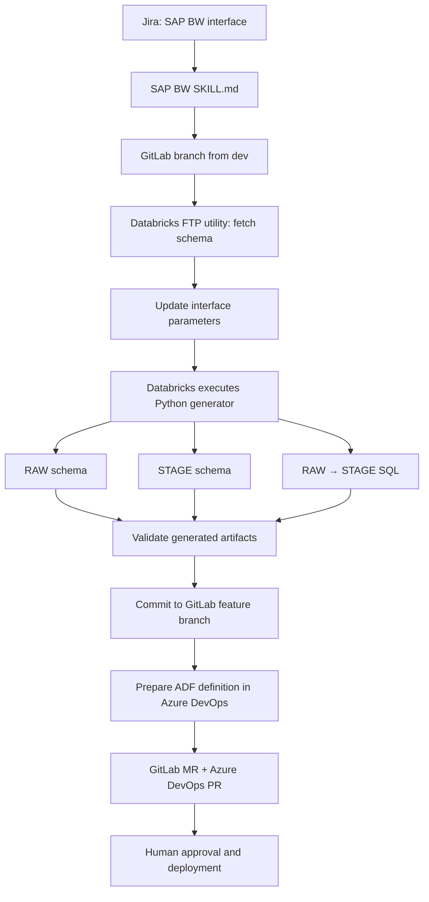
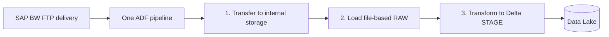

# SAP BW file-based integration

The upstream SAP BW team delivers files to a shared FTP server. Each interface has its own folder, usually for one country; a special multi-country interface may be mapped differently.

## File delivery

Typical interface files:

| File | Meaning |
|---|---|
| START flag | File transfer has started |
| Schema file | Source fields and types |
| CSV file | Extracted data |
| END flag | Completion state, e.g. Complete / Error |

The receiving pipeline should not treat a partially delivered file as ready. For production use, it should verify the relevant completion indicator, expected files, batch identity and duplicate-delivery handling.

## Provisioning

The Python generator replaces repetitive manual edits once performed from VS Code. In the reference design, artifacts are validated and committed through a controlled Git adapter. This avoids assuming that a Databricks Git folder automatically pushes newly created files.

## Runtime

The ADF pipeline invokes three Databricks processing steps and includes error monitoring. The generated transformation adds technical fields and country-aware partitioning. Several country-specific interfaces can feed one target table. A multi-country marker must not automatically overwrite actual country values in the data.

## Repository split

GitLab tracks interface settings, source schema and generated SQL. Azure DevOps tracks ADF pipeline definitions and their review/deployment workflow. A shared change-set ID links both reviews, but their merges are separate operations.
