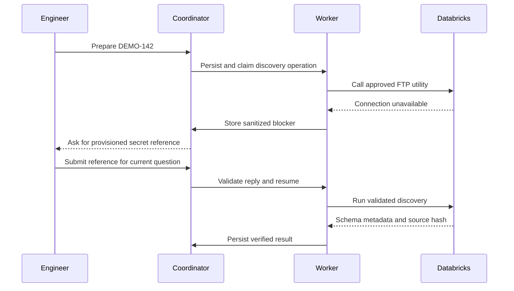

# One request, end to end

This is a synthetic SAP BW example illustrating the proposed contracts. Names, paths, fields and results below are invented. They are not production records or evidence of executed tests.

## 1. The request

| Field | Example |
|---|---|
| Ticket | DEMO-142 |
| Framework | SAP BW |
| Interface | DEMO_SALES_DE |
| Target | stage.demo_sales |
| Country / partition | DE / country_code |
| Connection reference | ftp-demo-ref |
| Requirement | Onboard the interface using the existing framework; prepare the required ADF definition |

The ticket does not contain a password, host address or real data. Schema fields come from the discovery tool, not the model.

## 2. What the skill contributes

Illustrative skill excerpt; this is documentation, not an installed skill:

```text
Framework: SAP BW onboarding
Required inputs: interface, target, country mapping, connection reference.
Use the approved FTP discovery notebook to obtain the interface schema.
Create a feature branch from dev and use its isolated Databricks working copy.
Update only the allowed interface parameter entries.
Run the existing generator; do not write replacement ETL.
Expected output: RAW schema, STAGE schema, RAW-to-STAGE SQL.
Report missing inputs. Stop on unsupported source or country semantics.
Return artifact references and validation evidence for review.
```

Backend policy separately supplies the tool allowlist, path restrictions, budgets and environment access. A skill cannot alter those controls.

## 3. One illustrative tool contract

| Contract field | Definition |
|---|---|
| Tool | discover_sap_bw_schema |
| Inputs | workflow revision, interface ID and connection reference |
| Backend checks | Authorized interface, permitted connection and pinned notebook |
| Execution | Adapter invokes the existing Databricks FTP utility |
| Success | Structured field/type metadata, schema hash and operation/run reference |
| Missing access | CONNECTION_UNAVAILABLE with a sanitized explanation |
| Excluded output | Credentials and CSV business records |

This is a logical contract, not a published API specification. Long-running execution first returns an operation reference; completion is persisted and validated before it is exposed to the model.

## 4. The human pause

Suppose the connection reference exists but its secret has not been provisioned.



The engineer provisions the secret outside the chat. The coordinator validates the current question and workflow revision. The worker then checks the reference through the tool. No model call runs repeatedly while waiting for the reply or external job.

## 5. Generation and review

The workflow prepares an isolated working copy attached to feature/demo-142 from dev, adds the interface parameters and invokes the existing generator. Illustrative changed files:

| File | Why it changes |
|---|---|
| interfaces/demo_sales_de.json | Interface, target and country parameters |
| schemas/source/demo_sales_de.json | Retrieved schema used as generator input |
| schemas/raw/demo_sales.json | Generated RAW schema |
| schemas/stage/demo_sales.json | Generated STAGE schema |
| transformations/demo_sales.sql | Generated RAW-to-STAGE transformation |

These paths are illustrative, not a reconstruction of an internal repository layout. A manifest records exact paths and hashes. The publishing adapter reads the validated files in the working copy and creates the GitLab commit. For this example a new ADF definition is required, so the workflow also prepares an Azure DevOps PR.

## 6. What passes and what fails

| Check | Pass condition | Example rejection |
|---|---|---|
| Input completeness | Interface, target and country mapping present | Target missing |
| Schema provenance | Mapping matches the discovered schema revision | Field invented from the Jira description |
| Generation | All expected files exist; parsers accept them | Missing STAGE schema |
| Transformation contract | Columns, types and country rules agree | Unknown source column or invalid partition mapping |
| Diff scope | Only allowed files changed | Generator modifies unrelated interface |
| Publication | Remote content matches manifest; required reviews exist | GitLab MR created but required ADF PR missing |

Static checks do not prove semantic correctness against real data. A test-environment run must additionally check representative records, target types, country values, completeness and rerun behavior under the interface contract.

## 7. The handoff

A review-ready summary includes the request revision, skill/generator revisions, source schema hash, artifact manifest, validation outcomes and both review links. It also lists which checks still require an environment run.

After review, the release controller records the immutable GitLab and ADF revisions and promotes the pair through the selected environments. In this example, failure to deploy the ADF definition leaves the new integration inactive. Production ingestion and data-quality checks remain a separate milestone.
